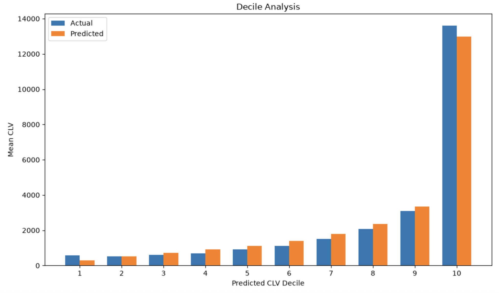
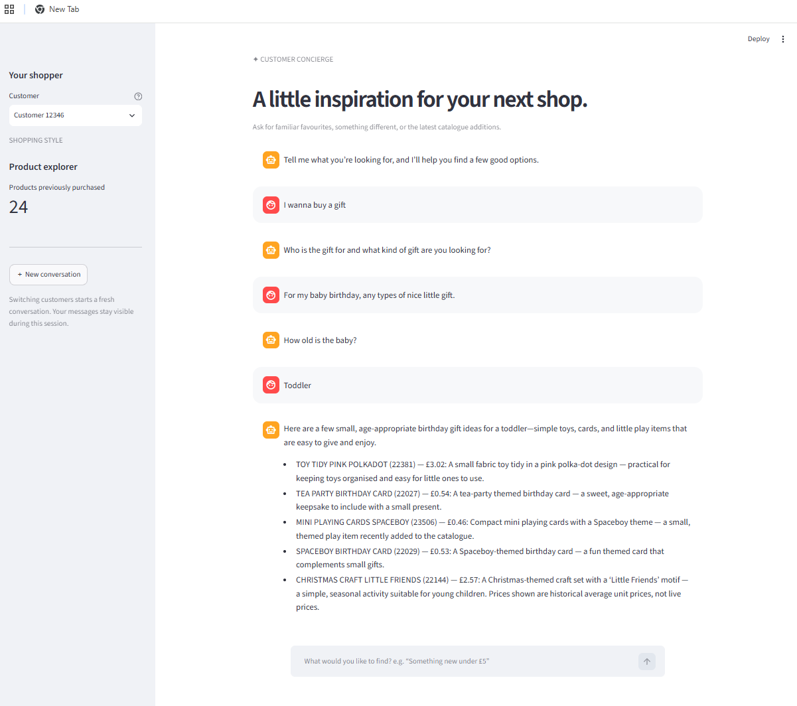

The project has two parts:

1. **Customer behavior analysis** (`00` to `04` notebooks): Customer Behavior modeling, and the evaluation of product
   recommendation models. Most of this README describes this part.
2. **Agentic product recommendation chatbot** (`a_prep_reco_data.py`,
   `b_recommendation_agent.py`, `c_app.py`): turns the best recommendation models
   into a conversational shopping assistant built with LangChain and LangGraph.
   See [Agentic Product Recommendation Chatbot](#agentic-product-recommendation-chatbot).

# Customer Behavior Prediction Case Study

This project builds an end-to-end customer analytics workflow for a UK online
retailer. Starting from raw transaction lines, it prepares calibration and
holdout datasets, cleans noisy retail data, predicts future purchase frequency,
estimates customer lifetime value, and evaluates several product recommendation
strategies.


The business goal is to answer three practical questions:

1. Which customers are likely to remain active, and which customers are likely
   to churn?
2. What is each customer's expected customer lifetime value (CLV)?
3. Which products should be recommended to each customer in the future period?

The analysis uses the UCI Online Retail II dataset, which contains transaction
history from a UK-based online retailer.

## Results

| Task | Holdout result |
| --- | --- |
| Zero-purchase prediction | ROC AUC: **0.748** |
| Aggregate CLV | Predicted **6.86M** vs actual **6.67M** (**+2.94%**) |
| Customer-level CLV | Pearson correlation: **0.913**; WAPE: **51.34%** |
| All-product recommendation | Precision@10: **0.388**; NDCG@10: **0.428** |
| New product recommendation | Precision@10: **0.113**; NDCG@10: **0.118** |
| New-catalogue recommendation | Precision@10: **0.126**; NDCG@10: **0.138** |

The recommendation results are from the combined LightGBM ranker trained on all
customer-product pairs, with the two-tower model trained on a GPU. Exact values
can shift slightly between runs and between GPU and CPU training.

The CLV estimates are most useful for ranking and segmenting customers rather than forecasting each customer's exact spend. The recommendation rankers outperform global popularity, including on the more difficult new-product tasks.


## Project Structure

| Notebook | Purpose |
| --- | --- |
| `00_Create_case_study_data.ipynb` | Downloads the raw Online Retail II data, creates a time-based calibration/holdout split, and builds product catalog files. |
| `01_Cleaning.ipynb` | Cleans calibration and holdout transactions, handles returns/cancellations, removes non-product activity, and creates order-level datasets. |
| `02_Purchase_Frequency.ipynb` | Fits a Pareto/NBD model to predict future purchase counts and customer activity. |
| `03_CLV.ipynb` | Fits a Gamma-Gamma monetary-value model and combines it with purchase-frequency predictions to estimate CLV. |
| `04_product_reco.ipynb` | Builds and evaluates product recommendation models, including popularity, repeat purchase, market-basket, semantic, two-tower, and LightGBM ranking approaches. It uses an NVIDIA GPU (CUDA) when one is available and otherwise runs on the CPU. |

## Data Flow

The notebooks should be run in order:

```text
00_Create_case_study_data.ipynb
        |
        v
01_Cleaning.ipynb
        |
        +--> 02_Purchase_Frequency.ipynb
        |           |
        |           v
        |      03_CLV.ipynb
        |
        v
04_product_reco.ipynb
```

## Input Data

The project uses the UCI Online Retail II dataset. The raw file contains
1,067,371 transaction lines with the following fields:

- `Invoice`
- `StockCode`
- `Description`
- `Quantity`
- `InvoiceDate`
- `Price`
- `Customer ID`
- `Country`

The transaction history is split using 5 December 2010 as the cutoff:

- Transactions on or before 5 December 2010 form the calibration period.
- Transactions after 5 December 2010 form the holdout period.

The calibration period is used for cleaning and model fitting. The holdout
period is kept as unseen future data for evaluation.

## Generated Files

The workflow creates the following main files:

| File | Description |
| --- | --- |
| `data/given_data/calibration_raw.csv` | Raw calibration-period transaction lines. |
| `data/given_data/holdout_transaction.csv` | Future-period transaction lines used for holdout evaluation. |
| `data/given_data/prod_catalog_calib.csv` | Product catalog observed during the calibration period. |
| `data/given_data/prod_catalog_holdout.csv` | Product catalog observed during the holdout period. |
| `data/working_data/calib_all_transaction.csv` | Cleaned calibration transaction-level data for recommendation modeling. |
| `data/working_data/calib_order.csv` | Cleaned calibration customer-order-level data. |
| `data/working_data/holdout_order.csv` | Cleaned holdout customer-order-level data. |
| `data/working_data/lifetimes.csv` | Customer-level RFM and Pareto/NBD outputs used for CLV modeling. |

## Cleaning Approach

The cleaning notebook prepares the raw retail data for modeling by:

- Standardizing identifiers, dates, customer IDs, product descriptions, and text
  fields.
- Matching negative-quantity rows to earlier positive sales to handle returns
  and cancellations.
- Removing administrative and non-product activity such as fees, postage,
  discounts, manual adjustments, and bank charges.
- Removing duplicate rows.
- Creating transaction-level data for recommendation modeling.
- Aggregating customer-day orders for purchase-frequency and CLV modeling.

This step converts noisy invoice-line data into stable customer purchase
histories.

## Purchase-Frequency Modeling

`02_Purchase_Frequency.ipynb` uses a Pareto/NBD model because the retailer is a
non-contractual business. Customers do not explicitly cancel, so churn must be
inferred from purchasing behavior rather than observed directly.

The model uses each customer's:

- Purchase frequency
- Recency
- Customer age

It estimates:

- Probability that the customer is still active
- Expected number of purchases in the holdout period
- Risk of zero future purchases

The purchase-frequency model overpredicts total holdout purchase volume, but it
still produces an informative customer ranking. Across 4,253 customers, it
predicts 17,025 purchases compared with 12,493 observed purchases. Customer-level
ranking remains useful, with strong Pearson correlation and moderate Spearman
correlation between predicted and observed purchase counts.

## CLV Modeling

`03_CLV.ipynb` combines:

- Pareto/NBD expected future purchases
- Gamma-Gamma expected average order value

The Gamma-Gamma model estimates each customer's long-run monetary value while
reducing noise in raw average order value, especially for customers with limited
purchase histories. The notebook uses a 50:50 blend of Gamma-Gamma expected
order value and calibration average order value as the final average order value
estimate.

The final CLV model performs best as a ranking and prioritization tool:

| Customer Group | Share of Actual Holdout CLV Captured |
| --- | ---: |
| Top 1% by predicted CLV | 29.35% |
| Top 5% by predicted CLV | 44.76% |
| Top 10% by predicted CLV | 55.22% |
| Top 20% by predicted CLV | 67.53% |

Predicted total CLV is close to actual holdout CLV at the portfolio level, but
individual customer-level predictions remain uncertain. The model is therefore
most useful for retention targeting, customer tiering, and marketing budget
allocation rather than exact per-customer revenue forecasting.

## Customer Lifetime Value Prediction

The CLV model was evaluated using decile analysis by ranking customers according to their predicted lifetime value and comparing the mean predicted CLV with the mean actual CLV within each decile. The model successfully separates lower-value from higher-value customers, with the highest predicted decile capturing customers with substantially greater realized lifetime value. The close agreement between predicted and actual CLV across most deciles indicates that the model effectively captures customer-value ranking.

<p align="center">
  
</p>

*Figure: Mean actual and predicted customer lifetime value across predicted CLV deciles.*

## Product Recommendation Modeling

`04_product_reco.ipynb` builds several recommendation approaches:

| Model | Description |
| --- | --- |
| Global popularity | Recommends products that are broadly popular across customers. |
| Repeat purchase | Recommends products the customer has purchased before. |
| Market basket | Uses product co-occurrence patterns to recommend items commonly bought together. |
| Content-based semantic model | Uses product descriptions and sentence-transformer embeddings to recommend semantically similar products. |
| Two-tower neural model | Learns customer and product representations for personalized scoring. |
| LightGBM ranker | Combines model scores and features into a supervised ranking model. |

The recommendation evaluation considers three tasks:

- Overall holdout purchase prediction
- New-to-customer product prediction
- New-catalog product prediction

The notebook evaluates recommendations using ranking metrics such as
Precision@k, Recall@k, MAP@k, and NDCG@k.

The final LightGBM stage is trained twice: one ranker for all customer-product
pairs, and a second ranker trained only on products the customer has not bought
before, which targets the new-product and new-catalogue tasks.

The sentence-transformer embeddings (`all-MiniLM-L6-v2`), the two-tower training
and the two-tower recommendation scoring run on the GPU when CUDA is available;
the notebook prints the device it selected. On an NVIDIA GeForce RTX 3080 the full
notebook takes about 30 minutes. See [GPU Support](#gpu-support-optional).

## Dependencies

The notebooks use Python and common data science libraries, including:

- `pandas`
- `numpy`
- `pyarrow`
- `openpyxl`
- `matplotlib`
- `seaborn`
- `scikit-learn`
- `scipy`
- `lifetimes`
- `pymc`
- `pymc-marketing`
- `arviz`
- `nltk`
- `sentence-transformers`
- `torch` (CUDA build on Windows and Linux; see [GPU Support](#gpu-support-optional))
- `tensorflow`
- `lightgbm`
- `implicit`
- `mlxtend`
- `tqdm`
- `jupyter`

Python and Python-package dependencies are managed with **uv**. The project uses
`pyproject.toml` to declare dependencies, `uv.lock` to record resolved versions,
and `.python-version` to select Python 3.12. From the project directory, run
`uv sync` to create `.venv`, download the required Python version if needed, and
install the locked packages. See the [uv documentation](https://docs.astral.sh/uv/concepts/projects/sync/).

System-level prerequisites are **Git**, **uv**, and a **C++ compiler** for normal
PyMC/PyTensor compiled execution. These tools must be installed separately;
`uv.lock` manages Python packages, not operating-system tools.

### GPU Support (optional)

An NVIDIA GPU is optional but speeds up `04_product_reco.ipynb`. On Windows and
Linux, `pyproject.toml` installs PyTorch (`torch`, `torchvision`, `torchaudio`)
from the PyTorch **CUDA 13.0** wheel index (`cu130`), so `uv sync` downloads the
CUDA build automatically; the CUDA runtime ships inside the wheels and no
separate CUDA Toolkit install is needed. You only need an NVIDIA GPU with a
current driver that supports CUDA 13.0 (driver 580 or newer). macOS installs the
standard PyTorch build and runs on the CPU.

The notebook selects the device automatically (`cuda` if available, otherwise
`cpu`), so the workflow also runs without a GPU, only more slowly. To check that
PyTorch sees your GPU, run from inside `customer-clv`:

```powershell
uv run python -c "import torch; print(torch.cuda.is_available())"
```

If this prints `False` on a machine with an NVIDIA GPU, update the NVIDIA driver
and run `uv sync` again.

### Windows Setup

Run these commands in **Windows PowerShell**.

1. **Install Git:**

   ```powershell
   winget install --id Git.Git -e --source winget
   ```

   Close and reopen PowerShell, then verify:

   ```powershell
   git --version
   ```

2. **Install uv:**

   ```powershell
   winget install --id astral-sh.uv -e
   ```

   Close and reopen PowerShell, then verify:

   ```powershell
   uv --version
   ```

3. **Install a C++ compiler for PyTensor:** The Pareto/NBD and Gamma-Gamma
   models use PyMC/PyTensor. The Windows setup tested for this repository uses
   WinLibs GCC/G++:

   ```powershell
   winget install --id BrechtSanders.WinLibs.POSIX.UCRT -e
   ```

   Close and reopen PowerShell, then verify:

   ```powershell
   g++ --version
   ```

4. **Clone the repository:** First navigate to the parent directory where you
   want to keep your GitHub projects, then run:

   ```powershell
   git clone https://github.com/amdirfan88/customer-clv.git
   cd customer-clv
   ```

5. **Reproduce the Python environment:** From inside `customer-clv`, run:

   ```powershell
   uv sync
   ```

   This creates the project's virtual environment and installs the required
   Python version and packages using the project configuration and lockfile.

6. **Start JupyterLab:** From inside `customer-clv`, run:

   ```powershell
   uv run jupyter lab
   ```

### Windows PyTensor Troubleshooting

PyTensor dynamically compiles native modules during model fitting. If an error
contains `An Application Control policy has blocked this file`, Windows Smart
App Control / Application Control may be blocking a generated compiled module.

Review **Windows Security → App & browser control → Smart App Control settings**.
Read the Windows warning before changing the setting: depending on your Windows
configuration, turning Smart App Control off may not be reversible without
resetting or reinstalling Windows. See [Microsoft's Smart App Control FAQ](https://support.microsoft.com/en-us/windows/security/threat-malware-protection/smart-app-control-frequently-asked-questions).
This is troubleshooting guidance, not a required installation step.

### macOS Setup

The project has also been tested on macOS. Ensure Git and
[uv](https://docs.astral.sh/uv/getting-started/installation/) are installed and a
C++ compiler is available. In the tested macOS environment, PyTensor uses
Apple's `clang++`; verify it in Terminal with:

```bash
clang++ --version
```

In Terminal, navigate to your preferred parent directory, then run:

```bash
git clone https://github.com/amdirfan88/customer-clv.git
cd customer-clv
uv sync
uv run jupyter lab
```
Run `uv sync` and `uv run jupyter lab` from inside `customer-clv`.

## How to Run

After completing the setup above, open the notebooks in JupyterLab and run all
cells in each notebook in this order:

1. `00_Create_case_study_data.ipynb`
2. `01_Cleaning.ipynb`
3. `02_Purchase_Frequency.ipynb`
4. `03_CLV.ipynb`
5. `04_product_reco.ipynb`

Keep JupyterLab running from the project directory so relative data paths
resolve correctly. The first notebook downloads the raw dataset and requires
internet access. See [Data Flow](#data-flow) and [Project Structure](#project-structure)
for the notebook dependencies and purposes.

## Key Takeaways

- A time-based calibration/holdout split gives the project a realistic
  future-prediction setup.
- Pareto/NBD is appropriate for non-contractual churn because customer dropout
  is latent.
- CLV predictions are strongest for ranking customers, not for exact
  individual-level revenue estimates.
- A small share of high-ranked customers captures a large share of future value,
  making the CLV model useful for targeting decisions.
- Product recommendation quality should be judged across multiple objectives,
  especially repeat purchases, new-to-customer discovery, and new-catalog
  recommendations.

## Agentic Product Recommendation Chatbot

The second part of the project puts the recommendation models behind a chat
interface, so a shopper can ask for products in plain language and get a short
list of suggestions.

<p align="center">
  
</p>

*Figure: The Streamlit chatbot for one customer (a product explorer with 24
previously purchased products). The assistant asks short follow-up questions and
then recommends five products.*

In the screenshot, the shopper starts with a vague request ("I wanna buy a gift").
The assistant asks who the gift is for, learns that it is for a baby's birthday,
asks for the baby's age, and, once the shopper answers "Toddler", recommends five
products. Each recommendation shows the product name, stock code, historical
average price and a one-line reason, ending with a reminder that prices are
historical averages, not live prices. The sidebar shows the selected customer and
their shopping style, which the agent uses to decide whether to favor familiar or
new products. The follow-up answers work because earlier messages are passed back
to the agent as conversation history.

The part is split into three scripts that are run in this order:

| Script | Role |
| --- | --- |
| `a_prep_reco_data.py` | Runs the modeling offline. It reproduces the data preparation and the recommendation models from the notebooks, assigns each customer a shopping style (infrequent shopper, repeat shopper or product explorer), trains the two-tower model on all calibration customers (on the GPU when available), and saves per-customer rank tables to `data/working_data/`. |
| `b_recommendation_agent.py` | The agent. It reads the saved rankings and answers one request for one customer. It can also be run directly from the command line. |
| `c_app.py` | A Streamlit chat page that shows the conversation, lets you pick a customer, and passes the previous messages to the agent. It contains no recommendation logic. |

### How the agent works

The agent is a LangGraph pipeline in which the language model never chooses
products. It only reads the request and writes the reply:

1. **Understand the request.** The language model turns the message, together
   with the conversation history, into a structured request: whether the customer
   wants to buy again or try something new, price limits, how many products, a
   short description of the product wanted, and anything to exclude. If a request
   is too broad it returns one short clarifying question instead.
2. **Choose the ranking.** Plain code picks the saved ranking that fits: the
   repeat-purchase ranking for buy-again requests and the two-tower ranking
   otherwise. When the customer states no preference, their shopping style only
   decides which products come first.
3. **Apply constraints.** Plain code removes products that break the request:
   price range, previously purchased or not, newly added to the catalogue, and
   exclusions. If a product description was given, products are kept when their
   description is close in meaning to it, measured with text embeddings rather
   than exact word matches. The best-ranked products that remain are selected.
4. **Explain.** The language model writes a friendly reason for each selected
   product, and the reply is rejected if it adds or drops a product. If no
   product survives, the reply says which kind of constraint caused it, for
   example the price range, instead of returning a generic message.

### Running the chatbot

The chatbot needs an OpenAI API key. Create a `.env` file in `customer-clv`
containing `OPENAI_API_KEY=...`. `RECOMMENDATION_MODEL` and `EMBEDDING_MODEL` can
optionally be set to change the chat and embedding models.

From inside `customer-clv`, after `uv sync`:

```powershell
uv run python a_prep_reco_data.py
uv run streamlit run c_app.py
```

`a_prep_reco_data.py` creates its output files only once and skips any that
already exist, but its first run trains the models and takes a while. The first
chatbot request after it also computes embeddings for the product descriptions and
caches them in `data/working_data/catalog_embeddings.npz`. To try the agent
without the web page:

```powershell
uv run python b_recommendation_agent.py --customer-id 12347 --query "Something new under £5"
```

The chatbot's answers are generated with a language model, so the exact wording
can differ from the screenshot.